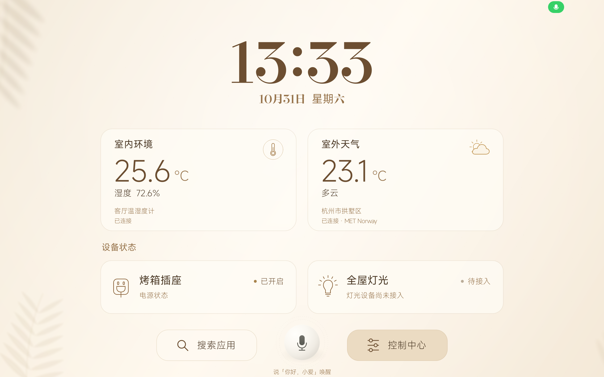

# home_pad

把小米 Pad 5 Pro 变成暖色家庭面板，集中查看时间、天气、室内温湿度和设备状态，并通过 ChatGPT 语音查询家居信息。



*小米 Pad 5 Pro 横屏实机效果，画面来自 v2.1.1，读数为拍摄时的 HA 状态记录。*

- 暖米色背景、大时钟与留白，常用家居信息抬眼可见。
- 首页展示状态，底部提供应用搜索、中央语音入口和控制中心，设备操作集中在控制中心。
- 点击麦克风进入 ChatGPT 语音，已在实机完成室内温度与插座状态查询。首页前台提供“你好，小爱”本地唤醒入口。
- Home Assistant 在平板本地运行，基础状态读取可独立于 Mac 与 USB 数据通道工作。ChatGPT 语音会话由在线 Mac 上的语音服务管理。

下文命令均在克隆后的仓库根目录运行。

## 许可与隐私

本项目原创代码与文档采用 [MIT 许可](LICENSE)，允许使用、修改、分发和商用，分发时须保留版权及许可声明。构建依赖与模型的许可见 [第三方声明](THIRD_PARTY_NOTICES.md)。

仓库只包含经审查的源码、文档、界面截图与有界验证记录。HA / 小米账号授权、语音配对 token、签名密钥、原始配置与运行日志保留在本地忽略目录。请使用自己的配置与授权，提交前执行 `gitleaks git .` 检查待公开的历史；截图与自定义验证记录仍需单独检查个人信息。

## 项目安装 skill

仓库包含可直接调用的 [home-pad-setup](.agents/skills/home-pad-setup/SKILL.md)。在本项目 checkout 中启动 Codex，输入 `$home-pad-setup` 即可由智能体组织环境检查、依赖准备、构建升级和只读验收。

Quick Start 的入口为开启开发者选项、打开 USB 调试并授权电脑，然后在 Codex 中打开本项目并运行下面的提示。具体系统菜单路径见 [Quick Start](.agents/skills/home-pad-setup/references/setup.md#quick-start)。

```text
$home-pad-setup 检查已连接的小米平板，安装或升级 home_pad，只查询设备状态，保持现有供电状态。
```

当前自动化范围为 macOS/Linux 构建主机、已授权 ADB 的小米 Pad 5 Pro，以及平板本地已有的 Home Assistant。首次 HA 安装、账号授权与面板家居连接使用用户自己的正常设置流程，后续升级保留原配置。具体前提与步骤见 [部署说明](.agents/skills/home-pad-setup/references/setup.md)。

```sh
python3 .agents/skills/home-pad-setup/scripts/home_pad.py doctor
python3 .agents/skills/home-pad-setup/scripts/home_pad.py setup --config /absolute/private/tablet-config.json
```

`--config` 指向本机用户自有、权限 0600 的 HA 配置文件，字段包含用户自己的 `token` 与实际 `entity_id`，不得提交。一个已授权设备时自动选择，多设备时传 `--serial`。工具链支持项目现有目录，也支持标准 `JAVA_HOME`、`ANDROID_HOME`，需要 JDK 17、Android Platform 33 与 Build Tools 35.0.0。

安装入口核对包名、原签名、版本和 APK 哈希。相同 APK 返回 `already_installed`，升级前检查采样和语音占用，并在安装后回读哈希与 HA 状态。只读验证仅请求 HA 配置和指定设备状态，结束时移除自己创建的诊断端口。脚本不会通过设备通断来验收。

```sh
python3 .agents/skills/home-pad-setup/scripts/home_pad.py setup --apk outputs/极简搜索桌面.apk --config /absolute/private/tablet-config.json --check-only
python3 .agents/skills/home-pad-setup/scripts/home_pad.py build --check-only
python3 -m unittest discover -s .agents/skills/home-pad-setup/scripts -p 'test_home_pad.py' -v
```

本次 skill 通过 23 项离线回归、隔离构建、当前平板只读查询和相同 APK 幂等检测。真实覆盖安装路径由离线测试验证，本次实机未执行覆盖安装或设备通断。核验记录见 [安装 skill 验证](outputs/安装Skill验证.json)。

## 文件位置

- `work/minimal-launcher/app/`：当前源码版本 2.6.1（versionCode 29），日光庭院首页只展示状态，底部依次为应用搜索、中央语音图标和控制中心。
- `work/minimal-launcher/build.py`：APK 构建脚本；`--check-only` 生成隔离的未签名验证产物，不更新签名或 `outputs/`。
- `work/minimal-launcher/prepare_wake_dependencies.py`：准备并校验固定版本的本地唤醒依赖；下载与准备文件保留在忽略上传的 `tools/wake-deps/`。
- `outputs/`：本地交付目录；仓库只纳入经审查的文档、截图和验证记录，APK 与源码压缩包不上传。
- `work/tablet-ha/`：将 Home Assistant 迁入平板的安装脚本、运行环境和迁移记录。
- `work/homeassistant/`：原电脑端 Home Assistant 配置、私有授权和辅助脚本。
- `work/tablet-debloat/`、`work/root-prep/`：此前的预装应用备份和解锁研究材料。

构建前仍需准备本机 JDK 17、Android API 33 与 Build Tools 35。首次准备唤醒依赖并进行隔离构建：

```sh
python3 work/minimal-launcher/prepare_wake_dependencies.py
python3 work/minimal-launcher/build.py --check-only
```

准备脚本下载固定 SHA256 的 sherpa-onnx 2.0.1 Java/JNI、中文移动端关键词模型和许可文件；构建时校验并打包 arm64-v8a 依赖。脚本随源码提交，模型、JAR、原生库及构建产物不上传 Git。`--check-only` 不签名、不安装，也不覆盖已有 APK。需要正式本地交付包时再运行 `python3 work/minimal-launcher/build.py`，沿用原签名并更新本地输出；构建脚本本身不安装到平板。

## 2.6 控制中心直接操作

2.6.1 首页环境总览调整为室内湿度、室外天气两栏，移除单独的室内温度展示。

开启、关闭等明确动作点击即执行。需要参数时，填写后点击「执行」或直接选择选项。操作按钮显示「处理中…」，结束后按回执显示「已完成」「已发送」「失败」或「未确认」，4 秒后恢复原标签。请求处理中禁止重复提交。

「已完成」要求读到对应目标状态；窗帘位置反馈尚不可信，提交成功显示「已发送」。取消、超时和结果不明均不会自动重发设备指令。

## 2.5 控制中心

默认打开常用设备。横屏从左侧切换房间，竖屏从顶部切换，选择「全部设备」可按房间查看完整目录。卡片只展示主要状态和操作，其余功能放在设备详情，参数和诊断单独分页。环境和设置从顶部打开。

2.5.2 在面板前台每 15 秒自动读取设备目录，首页和控制中心随读取结果更新。请求执行期间跳过该次轮询，离开面板时停止轮询，返回时立即刷新。桥接或网络恢复后会自动更新状态；设备服务没有自动重发。

2.5.3 首页仅展示在线且具有有效主要状态的常用设备，离线或状态未知的设备自动隐藏，恢复后随状态刷新重新出现。显示项按常用顺序连续排列，完整设备目录在控制中心查看。

2.5.4 首页加入客厅「灯具总线」的主开关状态，以及主卧、次卧、书房的空调读数。空调区分室温、设定温度与开关状态，缺失温度不填默认值；横竖屏按在线常用设备数量调整行高。

2.5.5 从首页状态区移除窗帘和窗纱，相关操作入口集中在控制中心。

## 2.4 界面统一（历史版本）

控制中心优先展示设备，按房间分组，宽屏并排、竖屏单列；返回和设置入口保持在顶部。烤箱插座仅显示主电源状态与开启、关闭按钮，窗帘和窗纱提供打开、关闭及其他操作菜单。温湿度读数并排展示，更多只读状态可展开。环境来源与连接设置保留在控制中心。

首页六个展示位加入主卧窗帘与窗纱，仅表示接入可用性，不将尚未确认的窗帘位置显示为物理开合状态；未接入设备继续明确标注。搜索增加清空按钮与无结果提示，键盘弹出时为控制中心留出可滚动区域。语音页和原生设置弹窗统一暖色、圆角和按钮层级，语音连接设置仍使用原有配对流程。

2.4.0 已沿原签名安装，首页、控制中心、设置菜单及搜索完成横竖屏只读验收。语音页的 12 组排版检查使用离线样例，未启动云端语音；不代表语音连通、唤醒、窗帘运动或长期稳定性验证。触控确认、语音执行限制和设备桥接边界未改变，窗帘打开异常仍需独立排查。

2026-11-05 保全原只读采样日志后，已在原小米集成中新增 17 台设备，米家目录达到 19 台。加入两台天猫窗帘与只读奋腾达吸顶灯后，控制中心实机显示 22 台设备。接入后按 Home Assistant 的实体状态显示可读、未知或暂不可用。

## 2.3 日光庭院首页（历史版本）

按已选视觉稿更新原生首页：保留暖米白、日光庭院与中央语音入口，将室内温度、湿度和室外天气合并到一个环境总览；时间和日期靠左排布，常用设备扩为两列六个展示位。数字字体使用随包附带的 Bodoni Moda，图标使用 Tabler outline；背景为不含界面文字的独立生成素材，界面文字、读数和交互仍由原生代码绘制。

六个展示位为烤箱插座、客厅大灯、客厅空调、主卧灯、主卧空调和智能晾衣架，名称来自此前核对的本户账号清单。展示位不是新增设备导入：状态仅取现有本地目录和插座读取器；未导入的名称显示“待接入”，网络或读取失败显示未知/不可用，不能把六个位置写成六台已接入设备。温湿度、天气及来源说明继续采用真实读取结果；天气不可用时保留缺失状态。此轮没有保存全量设备导入或重载小米集成。

首页仍只有搜索、语音、控制中心三个操作入口。环境和设备区域不可点击操作，点击、长按或无障碍操作均不能发出设备服务。语音、唤醒和控制确认逻辑未改动。该版沿用原签名升级，完成横竖屏界面和只读状态验收。

## 2.2 全设备接入进度

2.2 已沿用原签名安装。控制中心新增按房间分组的设备目录、设备/功能搜索、只读状态及类型化操作；首页仍不可操作，麦克风样式保持 2.1.1 的参考图设计，灯光摘要改为从完整本地目录读取。触控操作保留最终确认，明确的单条语音命令不另行确认。

2.2 验收时 HA 仅导入原有 2 台设备，其余 17 台等待原采样窗口结束和最终日志保全。2026-11-05 已完成实际导入及设备目录回读，当前接入情况见上文。

Codex 路径新增 `get_home_devices` 与 `control_home_device`。平板使用私有设备注册表投影，将真实实体映射为不透明引用；目录与原 HA 连接绑定，凭据和原始实体 ID 不进入语音服务或模型。支持的操作取决于真实域、服务字段、功能标志、枚举与数值范围；传感器、网关、离线项及不支持的能力不提供执行入口。小米用 `*` 标记的未映射自定义参数在当前投影中按只读配置处理，避免把清码、控制器模式等底层设置当作普通家居功能。

原生执行器核对完整目标、实际观察到的原话、目录版本、数值及温度单位；同名设备、疑问、否定、含糊数字、后续纠正或过期证据会被拒绝。每次语音会话最多接受一次控制尝试；查询或闲聊后再控制应重新开始。每个票据最多发出一次服务请求，取消和离页可阻止尚未发出的命令，已发出的命令不能被撤回。回复区分请求已提交与状态未确认；没有进行任何真实设备开关或调节测试。

当前验证、待导入范围及原采样保护边界见 `outputs/全设备接入2.2验证.json`。语音仍需要 Mac 上的 Codex 语音服务在线；平板本地 HA、状态读取和控制中心不依赖这个服务。原有稳定性跟进负责截止后的日志核验与剩余导入，不重新开始或延长采样。

## 2.1.2 历史控制范围

该版本链路为 ChatGPT Voice → Codex 家居工具 → 平板原生校验 → 平板本地 HA。当时可控目标为烤箱插座的固定开/关；温湿度和天气可查询，灯、空调、窗帘尚未接入。服务和原生端的正常控制权限均已回读为开启，明确指令无需二次确认。

2.1.2 已安装，语音页现在显示这些能力与使用限制：在新的语音对话连接成功后，直接说“打开烤箱插座”或“关闭烤箱插座”；每次对话最多一次控制尝试，查询或闲聊后再控制须重新开始。现有原话校验和白名单保持不变。本次通过源码审查、模式回读及离线测试确认链路，没有进行真实通断或新增设备导入，也没有重启 HA 或记录器。详见 `outputs/语音家居控制2.1.2验证.json`。

## 2.1.1 语音图标

已按用户参考图将首页中央图标改为米白球面、柔影、深灰麦克风与两层细虚线圈，并沿用原签名安装到平板。原点击区域、语音入口、唤醒与家居逻辑未改；横屏状态文字略下移以留出外圈。已检查横竖屏离线预览和横屏实机截图，本次没有进入云端语音或测试插座开关。HA 与稳定性记录器进程身份未变，插座报告仍为开启，原长测不重置。详见 `outputs/语音图标2.1.1验证.json` 和 `outputs/语音图标2.1.1实机.png`；下方 2.1 语音验证是功能基线，不是 2.1.1 重新测试的结果。

## ChatGPT 语音 2.1

2.1（versionCode 13）已沿用原签名安装，安装包摘要与平板上的 APK 一致。首页为暖米色时钟、日期和家居状态，卡片只展示；底部为搜索、中央语音、控制中心，触控操作集中在控制中心。

中央麦克风或“你好，小爱”进入同一个 ChatGPT 语音页面。本地 sherpa-onnx 只检测唤醒词，仅首页在前台、有窗口焦点且获麦克风权限时监听；后台、熄屏或其他页面停止，不保存或上传唤醒音频。进入对话先释放本地采音，再交给 WebRTC。对话不使用 Android SpeechRecognizer 或系统 TTS。

**当前通过官方 Codex app-server 的正常 ChatGPT 登录接通 V3 WebRTC，无需 API key。** Mac 上的 HTTPS 语音服务创建独立会话、转交家居工具，音频由平板直接传到 OpenAI。Codex 子线程只有受限的家居动态工具；shell、浏览器、外部 MCP 等能力禁用，正常登录由官方 CLI 自行管理，不导出 token、不冒用客户端身份。家居事实由平板本地 `get_home_status` GET 刷新，不向语音服务或模型提供 HA 令牌及实体 ID。HA 报告仍是缓存状态，不能当作实际功率测量。

最终 2.1 的两次实机声学查询已完成：点击中央入口后，“室内温度是多少”触发本地查询并由 ChatGPT 回答 25.6°C；“你好，小爱”唤醒后，“烤箱插座现在是什么状态”触发本地查询并回答开启。均准确观察到问题转写、一次工具请求与结果、云端回答文字，以及平板 AAudio 扬声器播放通路；退出后服务活动会话数归零。测试声音由 Mac 扬声器经空气进入平板麦克风，没有文字注入。一次唤醒成功不代表可靠率或熄屏唤醒可用。

服务已安装为当前用户的 `com.alex.homepad.voice` LaunchAgent，验证过只终止自己的语音进程后自动恢复。它需要 Mac 用户登录、Mac 未休眠和网络可用；未重新测试 Mac 重启、登出或休眠恢复。**平板本地 HA、首页状态与插座触控链路仍不依赖 Mac、USB 或这个语音服务。** 原生配对入口为“控制中心 → 打开设置 → ChatGPT 语音连接”，凭据经 Android Keystore 加密，TLS 验证主机名、有效期和证书摘要。部署说明见 `work/voice-service/README.md`。

实机查询期间两端均只读。完成后已按用户要求保存正常控制配置：服务允许控制，原生只读选项取消；保存后回读确认，没有打开新语音会话或发送设备命令。明确单条语音开/关命令无需二次确认，触控电源仍确认。原生端独立检查固定设备、实际观察到的用户原话、连接与读取状态。由于转录片段没有可作为授权依据的最终轮次标记，实现保守保留整个会话输入，最多接受一次电源意图；否定、纠正、混合查询或不匹配请求会拒绝，可能需要重新进入语音再说完整指令。不能宣传无限连续语音控制，**真实电源通断没有测试**。

退出、进入后台或失败会释放媒体并关闭自己创建的 Codex 会话；收到真实 `session.started` 且数据通道和连接就绪才显示已连接。最终检查包含 49 项原生工具守卫、28 项语音证据边界、33 项页面用例（249 条断言）和 79 项服务模拟测试。证据、初始失败及修复、部署配置与验证边界见 `outputs/Codex语音实机验证.json`；实机截图为 `outputs/ChatGPT语音温度查询实机.png` 和 `outputs/ChatGPT语音插座查询实机.png`。

本次三个短时只读观察窗口内，HA 和原稳定性记录器进程身份未变，插座报告保持 `on` 且 `last_changed` 不变，未观察到 HA 设备服务调用。没有重置、延长、回收或改写 soak。桌面升级、语音测试和配置保存仍属于原采样窗口内的主动负载，最终长测汇总须保留这些时间段；24 小时长期结论尚未完成。

### 2.0 历史验证范围

2.0 曾接入直接 GPT-Live API 路径，因缺 API 配置只验证了入口、唤醒、HTTPS 配对和失败后的资源释放，没有完成云端对话。那次 Codex V2/V3 探测使用 WebSocket，返回 `realtime conversation requires API key auth`；先前把它概括成“Codex 登录不能接语音”不准确，已由 2.1 的 WebRTC 实测纠正。`outputs/ChatGPT语音接入验证.json` 与“待配置”截图保留为历史证据，不能与 2.1 成功记录混用。

## 1.9 本地语音历史验证

1.9（versionCode 11）曾使用 Android ASR/TTS，随后被用户明确要求替换。该版已沿用原签名安装；2026-10-30 18:52–18:57 UTC 的短时实机验证观察到中央入口、一次“你好，小爱”声学唤醒成功，以及“室内温度是多少”返回 25.6°C；另一次唤醒未成功，部分早先查询没有听清，不能据此宣称可靠唤醒或所有查询通过。测试音频来自 Mac 扬声器，经空气进入平板麦克风，不是文字注入。

该窗口内 HA 的插座状态保持 `on`，`last_changed` 不变；被动订阅未收到设备服务调用，HA 和只读记录器的进程及启动标识未变。没有测试电源通断，也没有回收、重置或延长稳定性记录。桌面升级和麦克风测试属于采样窗口内主动负载，最终长测汇总必须保留这一时间段。详见 `outputs/本地语音1.9实机验证.json`。这份记录不能证明 2.0 已接通 ChatGPT。

原来的离线 1.9 验证记录和横竖屏设计图保留为历史证据；图中为示例数据，不是当前版本实机截图。

## 1.8、1.7、1.6 与 1.6.1 历史范围

此前 1.8 工作记录称该版已安装，测试随后按用户要求停止，实机结果尚未完整汇总。当时语音电源指令仍要求触控确认；这项旧行为和安装记录均不适用于 1.9，不能代替本版的唤醒或直接控制验证。

1.7 引入静态首页与控制中心，当时首页的另一个入口为“搜索应用”。该阶段未安装到平板，验证限于本地源码审查、编译和离线渲染，具体完成项及限制见 `outputs/静态首页与控制中心验证.json`；离线预览不是平板截图或真实设备操作证据。1.4、1.5 的截图和测试也仅证明各自历史版本。

1.6 的历史确认框检查见 `outputs/开关防误触验证.json` 及其中绑定的两张截图，仅代表旧版测试窗口。1.6.1 当时仅将星形图标替换为麦克风图标，点击仍进入应用搜索、长按仍打开设置，未新增语音识别或录音；其麦克风截图未建立充分的版本与实机检查关联，先前历史证据复核未纳入。以上历史记录不能替代 1.9 验证。

## 环境数据接入与 1.5 历史验证

以下内容对应 2026-10-30 的 1.5 历史记录，四个 Java 源码摘要匹配提交 `c6a0b57eea1c5b6ae245e5556f514aa928e7e01b`。检查当时米家授权可见的 19 台设备，发现 Home Assistant 原先只导入了插座；在同一个小米集成中新增客厅温湿度计 `miaomiaoce.sensor_ht.t2`，新增 1 台、移除 0 台，保留原插座。为应用选择变更重载过一次 `xiaomi_home` 集成，历史记录未报告 HA 进程重启。

天气接入 [Home Assistant 的 MET Norway 集成](https://www.home-assistant.io/integrations/met/)，配置为已配置区域代表点 `30.32, 120.14`，海拔 13 米来自当时的 Open-Meteo elevation 查询。该点用于地区天气，不代表家庭精确位置；没有更改 HA 全局位置。天气显示包含 MET Norway 来源署名，不把室外湿度填入室内卡片，也不推断空气质量。

1.5 桌面通过平板本地 HA 读取温度、湿度、天气三个实体，前台每 60 秒只读刷新；当时点击环境卡片立即刷新、长按查看来源及 HA 数据记录时间，长按桌面空白处或底部圆钮可打开来源设置。**这些是旧版操作，1.7 已将它们移入控制中心。** 记录时间说明 HA 何时记录了数据，不等同于传感器实际采样时刻。缺失或解析失败时不使用参考图数值。一次历史读取为室内 25.6°C、72.6%，室外 15.2°C、晴朗夜晚；这些是当时读数，不是固定显示值。

1.5 历史记录记载了沿用原签名升级安装，以及读数、记录时间、只读刷新、来源详情、横竖屏排版、搜索返回和温度来源失效时仍保留可用湿度、天气的检查；测试后已恢复来源。此次文档复核已与本地 QA 的构建日志、UI 转储、服务读取和截图核对，未重新运行实机测试。详见 `outputs/环境数据接入验证.json`；`outputs/环境数据桌面横屏预览.png` 与 `outputs/环境数据桌面竖屏预览.png` 均为 1.5 历史截图。

该次导入和集成重载发生在 24 小时只读采样窗口内。汇总时必须保留失败样本与缺口，并标注主动配置变更的时间关联；不能称为完整无人干预运行。HA 的 `last_changed` 在重载后的记录中变化，不能据此判断插座实际发生了切换。记录中未执行插座通断测试，也没有重置、延长或回收采样运行。

## 暖色桌面与 1.4 历史验证

1.4 的暖米色仪表盘使用植物阴影背景、大宋体时钟和设备本地日期，横竖屏自动调整布局。当时温湿度、天气尚未接入，显示占位；全屋灯光继续明确显示待接入。

1.4 的旧版操作为：底部星形圆钮进入应用搜索，长按桌面空白处或圆钮打开设置，点击插座文字区只读刷新，右侧开关是直接电源操作入口。**这些旧版入口不适用于当前版本；历史复核没有使用或测试真实开关。**

历史记录记载了 1.4 构建、原签名升级安装、横竖屏应用搜索、拼音 `shezhi` 与首字母 `sz`、打开系统设置、返回和 HOME 复位、长按菜单及插座文字区只读刷新。默认 HOME 应用保持不变；升级前后 HA 报告均为 `on`，`last_changed` 一致。这只是 HA 报告，不是实际功率测量，也不证明两次读取之间持续供电。

此次文档复核已将 `outputs/暖色桌面验证.json` 与本地历史构建、UI、服务读取及截图核对。`outputs/暖色桌面横屏预览.png` 与 `outputs/暖色桌面竖屏预览.png` 仅为 1.4 历史截图；该版没有重新做 Wi-Fi 丢失/恢复、重启或长期验证。

两个历史验证 JSON 中的 APK 大小、SHA256、源码摘要和签名检查结论保留为当时证据。其 APK 和源码包名称是当时使用的输出槽位，同名本地文件已可能被后续构建覆盖；不能按路径把当前产物当成旧版产物。APK 与源码包不随本次上传，截图通过各记录中的 SHA256 绑定。

## 平板本地服务迁移

2026-10-30 已完成平板本地迁移。Home Assistant 2026.10.4 与小米官方集成运行于平板的 Termux/proot 环境，桌面通过 `http://127.0.0.1:8123` 连接，原授权和加密保存的桌面令牌继续使用。运行链路不再经过 Mac 或 USB 转发，平板仍需连接 Wi-Fi；这不代表离线断网也能控制小米设备。

已在实机验证本地状态读取、Wi-Fi 关闭后立即禁用控制、联网后自动恢复读取，以及一次平板重启后服务和桌面自动恢复。当时 HA 报告插座状态为开启，迁移验证未发送 `turn_on`、`turn_off` 或 `toggle`。具体结果见 `outputs/平板本地服务验证.json`；这份迁移记录未覆盖真实通断、物理拔线与长期运行，后续拔线证据见下方稳定性记录。

另已清空 ADB 正向与反向映射、停止 Mac 上的 ADB server 并让平板熄屏 90 秒；恢复诊断连接后，平板本地服务仍可读取开启状态。这验证了该时段内无需 Mac 数据通道，USB 线仍物理连接。

Termux 和 Termux:Boot 已启用自启动，省电策略均为“无限制”。重启后需等待 Android 调度及 HA 加载；如设置了锁屏密码，还需先完成首次解锁。当前源码中的手动启动入口：控制中心 →“打开设置”→“启动插座服务”，稍后使用“刷新设备状态”。旧版入口以对应历史说明为准；本次语音升级没有执行该服务启动入口。

电脑端 Home Assistant、Colima 虚拟机和临时传输服务保持停止；`outputs/启动插座控制服务.command` 已改为平板操作提示，避免意外启动重复实例。不要同时启动电脑端和平板端的同一套小米授权。旧电脑端配置保留作本地备份。

本机只读诊断（需要 ADB 连接用于检查，日常运行不需要）：

```sh
python3 work/tablet-ha/verify_local_service.py
```

此脚本只请求 HA 配置与目标设备状态，使用临时诊断端口并在结束时移除，不启动电脑端 HA，也不调用设备服务。

## 独立运行稳定性记录

2026-10-30 已在平板安装本地只读采样器，默认每 60 秒读取 HA API 健康状态与目标实体状态，24 小时后停止。记录保存在平板 `~/tablet-ha/config/.soak/`，无需 Mac 或 USB 保持连接；重启续跑沿用原截止时间，不重新开始 24 小时。运行状态和拔线取证见 `outputs/平板独立运行稳定性验证.json`，采样窗口结束并回收日志前不能宣称长期验证通过。

用户已实际拔掉 USB，并在平板点击“刷新”后确认仍显示开启；同时 ADB 设备列表已无该平板，完成拔线后的独立状态读取验证。24 小时采样窗口从 10 月 30 日 09:35 到 10 月 31 日 09:35（America/Los_Angeles），拔线发生在采样开始后，两段时长必须分别计算。最初两条采样均成功；最终成功率、缺口和重启情况尚待回收日志确认。

用户已明确要求不再反复插拔。后续长期测试允许 USB 保持连接，验证平板本地 HA 的持续运行；Mac HA 保持关闭，不建立运行所需的 USB 转发。已有物理拔线刷新证据保留，不将接线情况下的稳定性结果描述成连续 24 小时拔线或电池续航测试。回收日志优先使用现有连接，不催促用户反复接线。

采样器只允许两个固定 GET 端点，记录响应耗时、错误类别、HA/proot 进程身份与采样缺口，不调用设备服务、不增加 wake lock。系统不允许读取的电池或温度字段记为 `null`。实体状态是 HA 的缓存报告，不能作为实际功率测量或每分钟直连插座查询的证明。

采样期间的 1.5 环境数据接入包含一次主动 `xiaomi_home` 集成重载，历史记录未报告 HA 进程重启。最终汇总必须保留全部失败样本和采样缺口，按时间关联 `outputs/环境数据接入验证.json` 中的主动配置变更，不能把这段窗口称为完整无人干预运行，也不能因配置变更而删除缺口或算作成功。原截止时间保持不变；1.7 源码和文档审查阶段没有访问平板，也没有回收、重置、延长或改写 soak 记录。1.8 曾进行安装，其实机结果待单独汇总；1.9 和后续语音升级的短时验证分别记录，不重置、延长、回收或改写既有 soak 记录。

`collect_soak_monitor.py` 已改造：原截止时间前不会调用 ADB，必须由调用者先新建并选中空白 Termux bash 会话，再提供其 PID 和启动 ticks。脚本核验新会话身份、焦点及 shell 自证，不发送 Ctrl+C，不打开或切换旧会话，不改写设备日志。三个原始文件保存到唯一新目录，生成 SHA256 收据；坏行、错误运行或未完成汇总仍保留原始数据并报告核验失败。新回收方式通过了离线测试，尚未执行最终实机回收；回收成功也不等于稳定性通过。后续用收据所在目录的 `samples.jsonl` 替换下例路径再离线汇总：

```sh
python3 work/tablet-ha/soak_monitor.py --summarize --output work/tablet-ha/soak-collected/samples.jsonl
```

拟回收范围仅为采样日志、运行时间元数据和汇总；不得读取令牌文件或改变服务进程。`install_soak_monitor.py` 是安装入口，会经临时本机通道传输现有非管理员令牌，源码不含实际凭据。原始记录只留本地，仓库只提交脱敏的结论与范围。

Termux/proot 为本项目自行维护的运行方式，不属于 Home Assistant 官方支持的安装类型；系统升级、强制结束 Termux 或后台回收后仍可能需要手动恢复。官方资料：[Home Assistant 安装方式](https://www.home-assistant.io/installation/)、[Termux:Boot 启动要求](https://github.com/termux/termux-boot)。

## 本地资料

天猫精灵设备可通过平板本地桥接加入 HA 与控制中心，运行时官方 App 位于独立虚拟屏。两台杜亚 V7 有打开、停止和关闭入口，客厅奋腾达吸顶灯支持只读电源状态。已知主卧窗帘的打开动作仍有异常。平板重启后目前需用 ADB 启动桥接。安装与故障处理见 [天猫精灵桥接说明](work/tmall-bridge/README.md)。

本项目包含账号授权、Android 签名和应用备份，仅存于本地；不要直接上传整个目录。源码压缩包只包含应用源码和构建脚本，不包含密钥。

旧工作目录下的 `work` 和 `outputs` 仅为指向本项目的兼容符号链接，供历史聊天文件链接、旧虚拟环境和虚拟机配置使用。实际文件均位于本目录；清理兼容链接前应先处理相关旧路径引用。

## Git 仓库范围

仓库保存桌面源码、构建脚本、Home Assistant 辅助脚本、平板服务启动脚本、预装应用清理与固件分析脚本，以及经检查的说明和桌面预览图。`.gitignore` 对 `work/` 和 `outputs/` 使用明确的纳入清单；新增文件前需检查是否包含授权、联系方式或设备私有数据。

以下资料只保留在本地：小米与 Home Assistant 授权和配置、签名密钥、临时传输密钥及包含它的安装脚本、客服沟通记录和联系方式、设备诊断截图与界面转储、APK 和固件备份、虚拟机、依赖环境、构建产物与日志。

从 GitHub 克隆后不能直接恢复当前设备环境。构建需准备 JDK 17、Android API 33 和 Build Tools 35，工具链支持标准环境变量与项目本地目录，并需运行唤醒依赖准备脚本；升级现有安装必须安全恢复原 `signing/` 目录。旧电脑端辅助和恢复脚本按自身位置定位项目，其授权、虚拟机与设备备份由使用者在本机准备。CLI 工具从 `PATH` 获取，旧电脑端停止脚本也支持 `HOME_PAD_COLIMA`、`HOME_PAD_DOCKER` 指定工具位置。运行验证以记录文件中的实测范围为准。

Git 已跟踪文本的可移植性检查纳入安装 skill 的回归测试，检查个人目录硬编码与本机迁移记录的误跟踪。本机迁移元数据保留在忽略上传的 `work/project-relocation.json`，兼容符号链接继续由本机维护。
